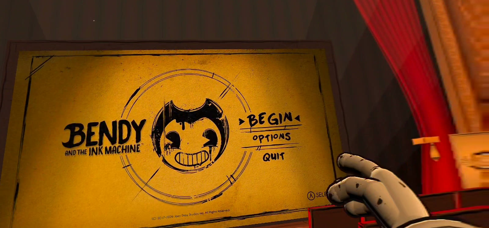
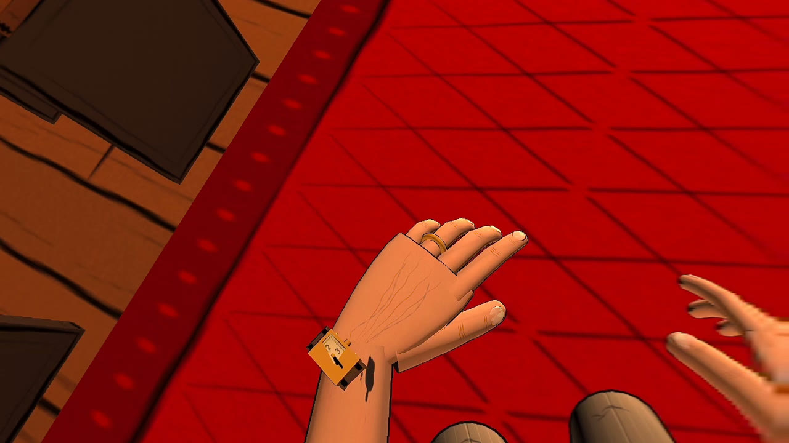
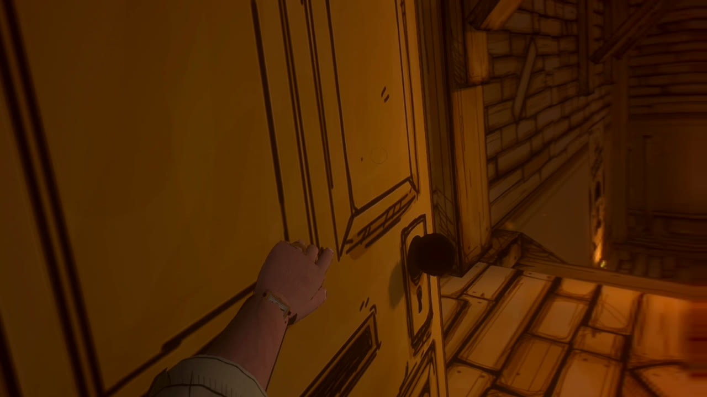

<!-- HERO IMAGE: docs/images/hero.jpg goes here when StrikeZoneVR sends the screenshots:

  

-->

<h1 align="center">InkVR</h1>

  <b>Step into the ink machine.</b> 
  A free PC VR mod for <i>Bendy and the Ink Machine</i>: full 6DoF, Henry's hands and body, and motion controls for everything.

  <a href="../../releases/latest"><b>Download</b></a> &nbsp;|&nbsp;
  <a href="#install">Install</a> &nbsp;|&nbsp;
  <a href="#controls">Controls</a> &nbsp;|&nbsp;
  <a href="../../issues">Report a bug</a> &nbsp;|&nbsp;
  <a href="https://ko-fi.com/strikezonevr">Support on Ko-fi</a>

> **PC VR only.** The game runs on your PC and streams to your headset (Virtual Desktop, Quest Link / Air Link
> or SteamVR). It does **not** run standalone on a Quest.

<!-- TRAILER: the launch trailer goes here when StrikeZoneVR sends it (a thumbnail linking to the video):
## Trailer

  

-->

---

## What it does

<!-- SCREENSHOTS: each row below gets a picture above its text, two per row, like this:
|  |  |
-->

| | |
|---|---|
| **Your hands, your body.** Look down and see Henry: cartoon gloves, braces and big shoes in the game's own style (or a Lifelike style), with a real wristwatch. Your arms are his arms. | **Doors by hand.** Push, pull or fling a door open; locked ones rattle. Turn valves and pump wheels, pull levers and flip switches yourself. |
| **Touch everything.** Press buttons, DOOR RELEASE and tape recorders with a fingertip, lift lids, open drawers and chests, pull the lid off a can of Bacon Soup and tip it to your mouth, play the organ and the piano, boop Bendy on the nose. | **Fight like you mean it.** Swing the axe with one hand or both: a hit counts anywhere on an enemy, and planks break where you strike. Guns aim where your hand points, with a two-handed grip. Throw darts, soup cans and chairs for real. |
| **Real-time ink.** Every drop lands on your hands, arms and clothes, runs and drips. Wade in and the ink ripples and splashes round you, and inky shoes leave footprints. | **Cutscenes in VR.** Scripted scenes play around you while you keep Henry's body. Your head does the looking, and the world never tilts or spins. |
| **Reach without walking.** Point at an item, grip and flick: it flies to your hand on an ink thread. Seated play lifts a seated view to Henry's height. | **A picture palace.** The menus play on the big screen of a 1930s theatre built in the game's style, and VR SETTINGS sits inside the game's own Options. |

Also included:
- Every chapter playable from start to finish, and the Archives.
- A weapon wheel (click the right stick) and an inventory card in your hand (hold Y), or the game's own buttons.
- Snap or smooth turning; seated or standing play.
- World size: AUTO makes Henry's eyes your eyes, or set it yourself.
- Body options: full body, arms and hands, hands only, or none; Toon or Lifelike.
- Each motion control can be switched back to a button in VR SETTINGS.
- Comfort: calm the theatre's projector flicker and film scratches.
- Automatic render resolution to hold the headset's frame rate.
- An animated launcher that installs, checks and uninstalls everything for you.

## What you need

- **Bendy and the Ink Machine on Steam** (PC).
- **A PC VR setup:** Virtual Desktop, Quest Link / Air Link, or SteamVR. InkVR uses OpenXR, with bindings for
  Meta Quest (Touch) controllers and Valve Index controllers. It was made and tested on a Meta Quest 3 streaming
  through Virtual Desktop; other headsets may work but are untested.

## Install

1. [Download the latest release](../../releases/latest) and unzip it into a normal folder (Desktop, Documents,
   `C:\Games\InkVR`). Keep `InkVR Launcher.exe` and the `InkVR-Payload` folder together. Very deep folders
   (paths over 260 characters) stop Windows from starting the launcher.
2. Start your VR runtime first (on Quest 3: the Virtual Desktop Streamer, then connect from the headset).
3. Run **`InkVR Launcher.exe`**. It finds the game through Steam and installs InkVR the first time (it downloads
   Unity's OpenXR plugin from Unity).
4. Choose **PLAY IN VR**.

**VR CHECK** in the launcher shows what's installed and anything that needs fixing.
`"InkVR Launcher.exe" --play vr` starts the game straight away, for a desktop shortcut.

## Controls

| Left controller | Right controller |
|---|---|
| Stick: move (click it to run) | Stick: turn (click it for the weapon wheel) |
| Trigger: run | Trigger: use your weapon, or swing your arm to hit |
| X: interact | A: jump |
| Y: inventory (hold it) | B: back, in menus |
| Grip: grab / use | Grip: grab / use |
| Menu: pause | |

Left-handed? Switch DOMINANT HAND in VR SETTINGS and the two sides swap. The launcher's **CONTROLS** page shows
the layout on a picture of the controllers, as you have it set up.

In the game, VR SETTINGS is in the game's own **Options** menu.

## If something looks wrong

| Problem | Fix |
|---|---|
| The world looks too big or too small | VR SETTINGS: WORLD SIZE. AUTO reads your height while you stand up straight, and uses it from the next level or when you resume. |
| Henry's body gets in the way | VR SETTINGS, HENRY: switch BODY to arms and hands, hands only, or none. |
| It stutters | VR SETTINGS, GRAPHICS: turn on AUTO RESOLUTION, or lower RENDER SCALE. |
| The launcher won't start | Move the folder somewhere shorter (see Install, step 1). |
| A motion control fights you | VR SETTINGS, CONTROLS: switch it back to the button. |

## Reporting a bug

Bug reports help a lot. [Open an issue](../../issues/new/choose) and attach:

- your log: `BepInEx\LogOutput.log` in the game's folder (in Steam, right-click the game, **Manage**,
  **Browse local files**). Close the game first.
- where in the game it happened, plus a short clip or a description;
- your headset and how you connect it (Virtual Desktop, Quest Link or SteamVR).

## Uninstall

Run `InkVR Launcher.exe`, open **OPTIONS** and choose **UNINSTALL INKVR**. It removes InkVR, the OpenXR plugin and
BepInEx's loader from the game folder. The game itself is not touched.

## Building from source

- The .NET SDK (6 or later), and Git Bash to run the scripts in `tools/`.
- The game, with InkVR's BepInEx installed and the game started once (BepInEx then generates the interop
  assemblies the plugin builds against).
- Set `INKVR_GAME_DIR` to the game's folder, then run `tools/build.sh` (the plugin) or `tools/package.sh`
  (the launcher, the payload and the release zip).

How it works inside, the roadmap and every build's test notes are in [PLAN.md](PLAN.md) and
[docs/TESTING.md](docs/TESTING.md). `tools/vr-start.sh` runs the game against Unity's OpenXR mock runtime, so most
things can be tested without a headset.

## Credits

- **StrikeZoneVR**: InkVR.
- The open-source parts:
  - [BepInEx](https://github.com/BepInEx/BepInEx) (LGPL-2.1), with
    [Il2CppInterop](https://github.com/BepInEx/Il2CppInterop) (LGPL-3.0) and
    [HarmonyX](https://github.com/BepInEx/HarmonyX) (MIT)
  - Unity's [OpenXR plugin](https://docs.unity3d.com/Packages/com.unity.xr.openxr@latest), downloaded from Unity
    by the launcher, not bundled
  - the [Bangers](https://fonts.google.com/specimen/Bangers) font (SIL Open Font License)

If InkVR made the studio feel real for you, you can [support it on Ko-fi](https://ko-fi.com/strikezonevr). Thank you!

## License

[GPL-3.0](LICENSE). Copyright (C) 2026 StrikeZoneVR.
The bundled libraries keep their own licenses.

*Bendy and the Ink Machine is a game by Joey Drew Studios Inc. InkVR is an unofficial, fan-made mod. It is not
affiliated with or endorsed by Joey Drew Studios, and it does not include any game files: the launcher and the
in-game menus read the game's art and fonts from your own copy at run time. You need your own copy of the game.*
